# A ConvNeXt Approach to Identifying Alzheimer's Disease Using ADNI Data

**Benjamin Bateman**
48819101

## 1 - Intro
### Algorithm
This paper goes through the creation of a ConvNeXt model for classifying data with an ADNI dataset. The ConvNeXt algorithm is built on the ResNet-50 algorithm, but adjusted in ways that made vision transformers successful. It is a convolutional neural network (ConvNet), and was built to figure out if a pure ConvNet could match the output performance of vision tranformers like the Swin Transformer. In this paper it is used to classify MRI scans from the ADNI dataset as having Alzheimer's or not.

#### Model Overview
The ResNet-50 model consists of a stack of 16 bottlenecked blocks, each computing a residual (F(x)) with each block being a 1x1, 3x3, then another 1x1 conv followed by a BatchNorm and ReLU. A skip connection (adding the input to the output of the block) allows gradients to permeate deep within the network. These blocks are repeated (3, 4, 6, 3) times, with downsampling happening after each block has been repeated the set number of times. A global average pool plus a linear layer produces the final score. This is used as the base comparison model against the ConvNeXt implementation.

ConvNeXt keeps the bones of this, moving in the direction of the Swin Tranformer. It starts with changing the training algorithm and hyperparameters. The hyperparamters used for this model can be found later in the paper. The block ratio is then changed from (3, 4, 6, 3) to (3, 3, 9, 3) and the stem, which previously contained a 7x7 conv followed be a maxpool, is replaced with a 4x4 stride 4 conv followed by a layernorm. The 3x3 conv is replace with a 7x7 conv and placed first in the bottleneck block. Said block is also inverted, going from wide-narrow-wide to narrow-wide-narrow. GELU replaces ReLU with only one activation function being used per block, and LayerNorms replace the BatchNorms. Downsampling is also changed, moving to a separate 2x2 stride 2 conv that exists between layers.

All information comes from 'A ConvNet for the 2020s'[1], which saw an increase from 76.1% to 82.0% on the same compute for ImageNet.

#### Process Overview

1. **Dataloading** 
- Data, as greyscale images, is loaded in batches of 64 from data/ADNI/AD_NC/{test\train}/{AD\NC}
- Data Augmentation - Image resized to 224x224, Random Horizontal Flip, Affine (5 degree, 3 percent shift)
- Normalise mean and standard deviation to (0.5, 0.5, 0.5), (0.5, 0.5, 0.5)
- Replicate single-channel greyscale over 3 channels

2. **Model**
- Batches are run through the model, described in the Model Overview above

3. **Train**
- Evaluates using BCEWithLogitsLoss() and gets confidence using the sigmoid function (evaluate found in predict.py)
- AdamW optimiser, no weight decay on normal parameters
- Linear warmup, then cosine decay
- AMP scaler on cuda
- Custom label smoothing on batches
- Mixup
- Stores the best result by validation-set accuracy

4. **Predict**
- Predicts slice and patient accuracy
- Finds best cutoff slice to be used to send patient to doctor's review

## 2 — Feasability Check
### User Need, Scope & Acceptance Criteria
Doctors, more specifically those involved in MRI screening and diagnosing Alzheimer's disease, are the primary user for this prototype. False negatives are far more detrimental than false positives, so the prototype will sort MRI scans into three categories: confidently positive, doctor’s review, and confidently negative. With this in mind, the following acceptance criteria will be met:
- A minimum 0.8 test accuracy on AD vs CN (Alzheimer’s Disease vs Cognitively Normal)
- Less than 0.05 false negative score on classifying AD. Cases sent to specialists will count as predicting AD.
- Post-training classification of the entire test-set in under a minute (10,000 images).
- As the model will be trained locally on an AMD Radeon 7800XT gpu, VRAM usage must not exceed 14.5 GB.
- The model should be trained within a reasonable time (under 4 hours).

### Model Choice & Course Concepts
The ADNI dataset found on Rangpur has data already split into training and testing sets, as well as AD and NC. Images from both AD and NC classes will be combined together and labelled to be used for training.

ConvNeXt, a neural network achieved by applying choices which made the Swin Transformer successful onto ResNet-50, will be the primary model used for training. In choosing this model, I am choosing the hard difficulty band for the project. As ConvNeXt aims to be an improvement on ResNet-50, ResNet-50 will be used as a baseline model to compare to. 

To get confidence scores for the classifications, the sigmoid activation function will be used. This function squeezes outputs, so that those closer to 0 or 1 are more confident predictions.
#### Preliminary Feasibility Evidence
There are 10400 AD and 11120 NC training images and 4460 AD and 4540 NC testing images. All images are 256x240 pixels. All images are greyscale, meaning only 1 input channel. 
Resources were estimated using batches of size 8, 16, 32, 64, and 128 testing on the 27.8 million parameters of torchvision’s built-in model convnext_tiny with an AdamW optimiser run on three optimizer steps. This was run on the aforementioned AMD GPU.
bs=8: peak VRAM=1321 MiB
bs=16: peak VRAM=2119 MiB
bs=32: peak VRAM=3869 MiB
bs=64: peak VRAM=7200 MiB
bs=128: peak VRAM=13925 MiB
With these numbers, I will likely train on either a batch size of 64 or 128, testing both to achieve the best model the fastest.
### Risks, Budget & Fallback
Patient level data leakage is possible, where a patient has slices in both test and training sets, so an id check will need to be done to ensure this hasn’t occurred in the provided data. 
As I will be running the training locally, my budget is entirely related to the AMD GPU data shown above. The next planned experiment is to train ResNet-50 on the training data, recording VRAM usage and time. If I am unable to train locally due to AMD rocm bugs (some issues with batchnorm2d), I will fallback to training on Rangpur. If I am unable to figure out the ConvNeXt programming itself, I will switch to doing the improved 2D Improved U-NET HipMRI task instead.

## 3 - Dependencies
### Python Libraries

To run main files:
torch 2.9.1
python 3.12.7
torchvision 0.24.1
matplotlib 3.11.2
numpy 2.5.3
Pillow 12.3.0
scikit-learn 1.9.1

Additionally to run prelim_testing.ipynb:
ipykernel 7.3.0

As this was trained on an AMD Radeon 7800XT, rocm 7.2.1 was used, but is not necessary with an NVIDIA GPU.
### Reproducibility
Use random seed of 123 for python random.seed, torch.manual_seed and torch.cuda.manual_seed

Create a -venv environment and pip install all above packages and versions.

Within the environemnt, run: 
python train.py
python predict.py

For additional evaluation, run:
python random_images_predict.py
python overfit_testing.py
python confidence_analysis.py

## 4 - Data-prepocessing
### Train, val, test split
It was vital to ensure that there was no patient-level data leakage between train, test or validation sets. The data is split by patient-id_slice-number, so all patient ids are separated and isolated to each set. It was verified that no patient overlap was pre-existing in the provided test and training sets.

In dataset.py, the val set is created by splitting off 15% of the train set's patient ids. These patient ids were split evenly into AD and NC to match the train set AD/NC ratios. After all sets were made, an additional assert was used to make sure of no data leakage.

This leaves an image distribution of:
train set - 18292
val set - 3228
test set - 9000

This gives a comprehensive test set, which is important when evaluating the performance of a medical imaging model that may be used with real patients. The validation set is still large enough to be used to tune the model well, and the train set still has over double the images of the test set, leaving enough to train accurately.

### Data Augmentation
Images have random horizontal flips and affine applied to them. Other data augmentation, like random erasing, was tried, but did not improve the model. The 1 channel greyscale images were replicated to 3 channels to better align with the ConvNeXt model start.

## 5 - Training Process

Many training runs were attempted to get the model to train at or above the 0.8 benchmark, between which many changes were made to the dataloading and hyperparameters.

### Data Loading
Random Erasing, which was used in the paper's training for ImageNet, majorly slowed down the training for ADNI, with a model that learned nothing and stayed around a 0.69 loss for the first 10 epochs. Subsequently, Random Erasing was removed.

Drawing the validation set from the train set produced better results than pulling it from the test set. Patient ids were kept separate in all sets, so the increase of around 0.01 was perhaps a lucky boost. Likely where the val set is drawn from makes no difference.

Mixup ([3]) was added, which also slightly increased performance by about 0.005. Batch size was kept at 64 due to hardware requirements. A learning rate too high (around 1e-3) produced unstable results and did not converge smoothly. Other parameters were tuned, but with limited compute time multiple changes often had to be made at once, which meant an in-depth analysis of how each paramtere affected model output was not possible. 

### Final Hyperparameters
The ConvNeXt and base ResNet-50 models were trained on the following hyperparameters:

EPOCHS = 40

WARMUP_EPOCHS = 4

LR = 5e-4

WD = 0.05

LABEL_SMOOTHING = 0.05   

BATCH=64

CUTOFF = 0.5

DROP_PATH = 0.1

MIXUP_ALPHA = 0.2   

MIXUP_PROB = 0.15

## 6 - Results

The models were trained on per-slice data, but a slice only represents a small subsection of a patient's MRI scan. Per-patient results were also recorded, taken by averaging the confidences of all slices from a patient's id and treating them as one large label.

### Example Inputs and Graphs

#### Example Slice Input
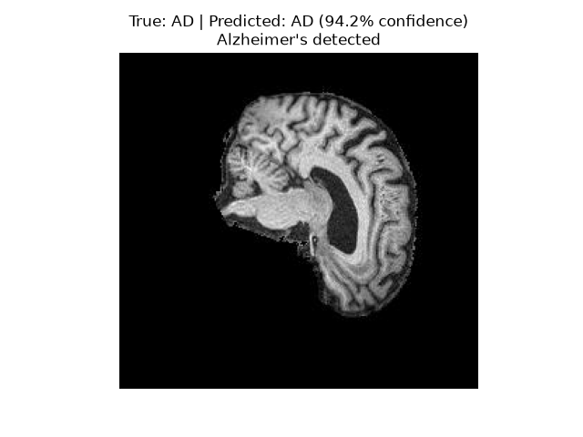
Above is a correct prediction on a random test image input.

#### ConvNeXt train vs val curves for accuracy and loss
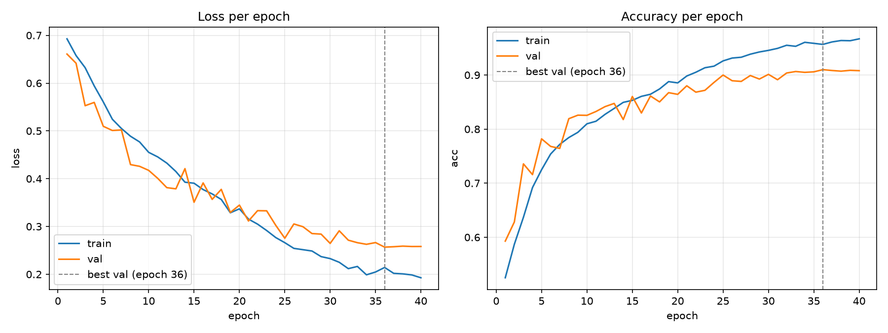
The fact that test accuracy is so much lower than val accuracy suggests that somehow the model is overfitting to the validation data. There are many possible reasons for the discrepancy, including sample population similarity and sampling variations. A train accuracy so high also implies that some degree of overfitting is occuring while training. 

#### AUC-ROC Curve for Slice Data on Both Models
| ConvNeXt | ResNet-50 |
| :--: | :--: |
| 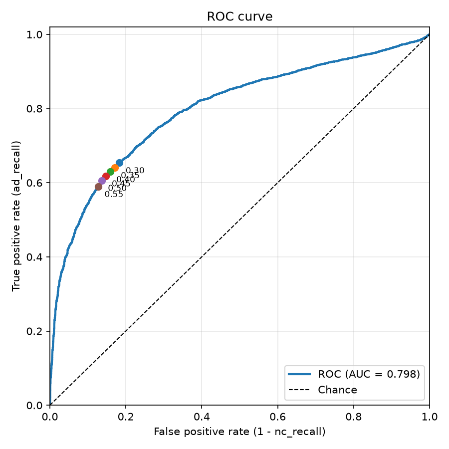 | 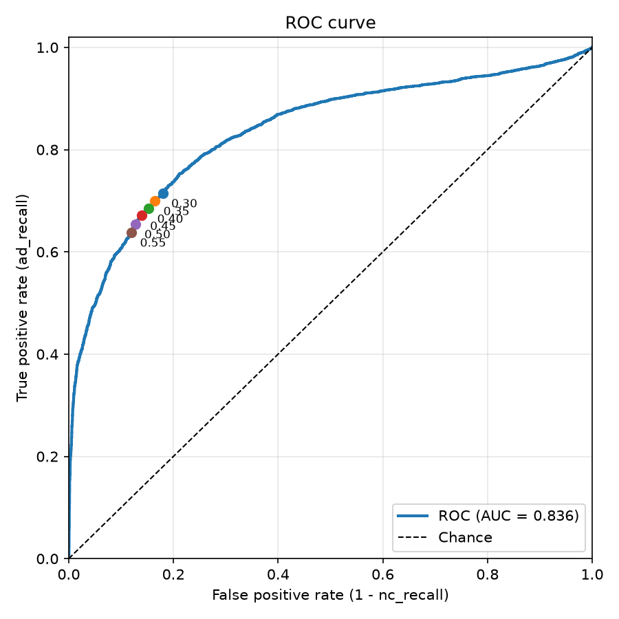 |

The dots on the graphs above represent cutoff points for determining if a slice is AD or NC.

#### Convolution Matrices on ConvNeXt and ResNet-50
| Model | Patient Data | Slice Data |
| :--: | :--: | :--: |
| ConvNeXt | 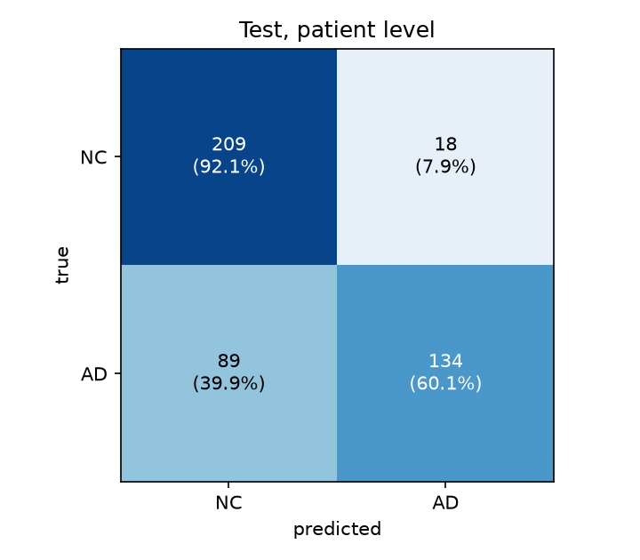 | 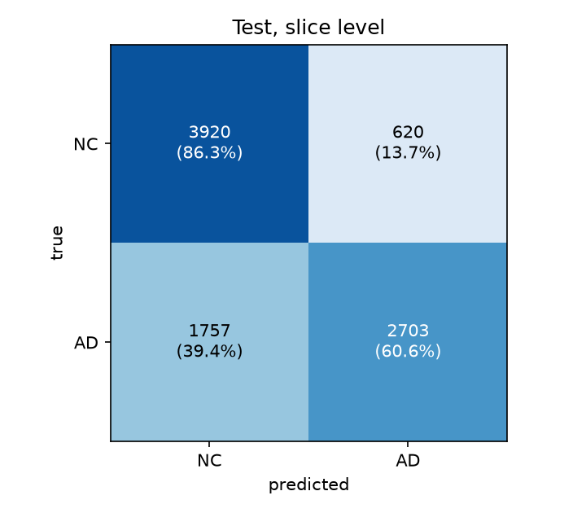 |
| ResNet | 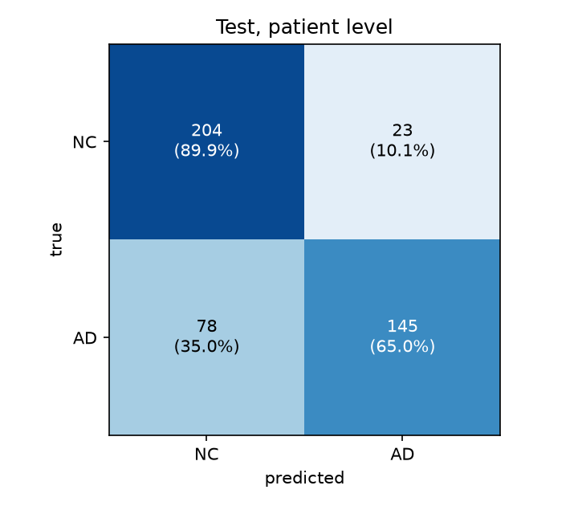 | 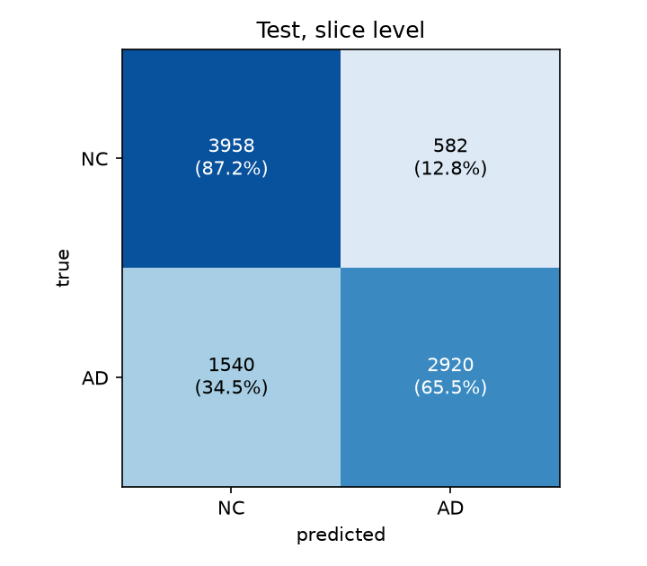 |

### ConvNeXt Comparison Against ResNet-50
#### Slice-level statistics
| Model | accuracy | ad_recall | nc_recall | ad_precision | nc_precision | macro_f1 | auc |
| :--: | :--: | :--: | :--: | :--: | :--: | :--: | :--: |
| ResNet-50 | 0.7669 | 0.6711 | 0.861 | 0.8259 | 0.7271 | 0.7644 | 0.8358 |
| ConvNeXt | 0.7368 | 0.6182 | 0.8533 | 0.8054 | 0.6946 | 0.7327 | 0.8061 |

#### Patient-level statistics
| Model | accuracy | ad_recall | nc_recall | ad_precision | nc_precision | macro_f1 | auc |
| :--: | :--: | :--: | :--: | :--: | :--: | :--: | :--: |
| ResNet-50 | 0.7844 | 0.6771 | 0.8899 | 0.858 | 0.7372 | 0.7816 | 0.8712 |
| ConvNeXt | 0.7822 | 0.6188 | 0.9075 | 0.8679 | 0.7079 | 0.7589 | 0.8467 |

### Resource Profiling
| Model | Peak GPU VRAM | Parameter Count | Evaluate Time | Time to Train |
| :--: | :--: | :--: | :--: | :--: |
| ResNet-50 | 3.06 GiB | 23.59M | 38.5s | 123m 36s |
| ConvNeXt | 4.13 GiB | 27.82M | 49.3s | 99m 59s | 

### Doctor's Review Experiment
An experiment was run in which data was split up into 'ad' 'review' and 'nc'. This data was split by the following rules. Per patient, if over 30% of slices were flagged as AD, it was flagged as AD. If etween 10 and 30% of slices were flagged as AD, it was sent to doctor's review. Otherwise it was flagged as NC.

Using this method, the missed AD dropped from 0.3229 to 0.175. In doing this, 0.260 of the NC set was flagged as either AD or review. This is still not good enough, as thousands of people would both be getting falsely diagnosed and faslely undiagnosed. Overall this is a positive, as more Alzheimer's patients would be getting diagnosed. More tests could be run to improve on this metric.

### Acceptance Criteria
| Criteria | Checked? |
| :--: | :--: |
| 0.8 test accuracy | No |
| Evaluation in under a minute | Yes |
| Training in under 4 hours | Yes |
| Max VRAM under 14.5 GB | Yes |
| False negative rate under 0.05 | No |

## 7 - Analysis

### Confidence Analysis

A confidence analysis was run, comparing the average confidence on correct and wrong predictions.
mean confidence, all:     0.8794  (confidence - accuracy = +0.1152, positive = overconfident)
mean confidence, correct: 0.8971  (n=6878)
mean confidence, wrong:   0.8219  (n=2122)
wrong predictions with confidence >= 0.9: 916

Of the 2122 misclassified slices, 916 were confidently wrong. An average confidence of 0.8219 on wrong predictions is 0.0752 less than on correct predictions which, while statistically significant, is quite high and difficult to adjust for. The model is likely too overconfident in general, so more training and regularisation methods should be used in the future.

More code was run (failure_autopsy.py) which compiled the mean P(AD) and number of slices called AD for incorrectly predicted patients. The threshold used to call it AD was 45% confident (that is 55% confident it is NC). The lowest 5 means were as follows:

Patient 1398870: mean P(AD) 0.039, 0/20 slices called AD

Patient 405621: mean P(AD) 0.045, 0/20 slices called AD

Patient 1175356: mean P(AD) 0.045, 0/20 slices called AD

Patient 1017725: mean P(AD) 0.049, 0/20 slices called AD

Patient 1175362: mean P(AD) 0.049, 0/20 slices called AD

And the average mean P(AD) was 0.2136. This implies that of the mislabelled Alzheimer's patients, many were overconfidnetly wrong. This backs up what we found above in the confidence analysis test. It is possible that the overfitting observed in section 5 led to such overconfident predictions.

## Failure Autopsy
| NC pred AD | AD pred NC |
|:--:|:--:|
|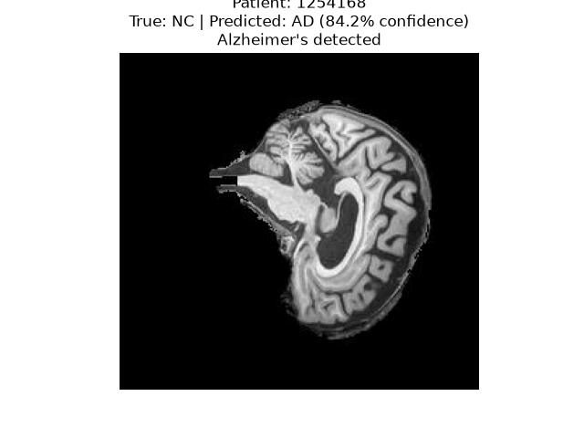|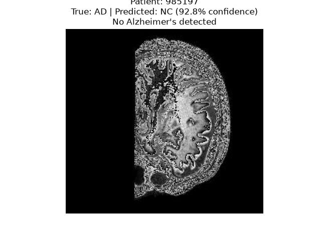|
|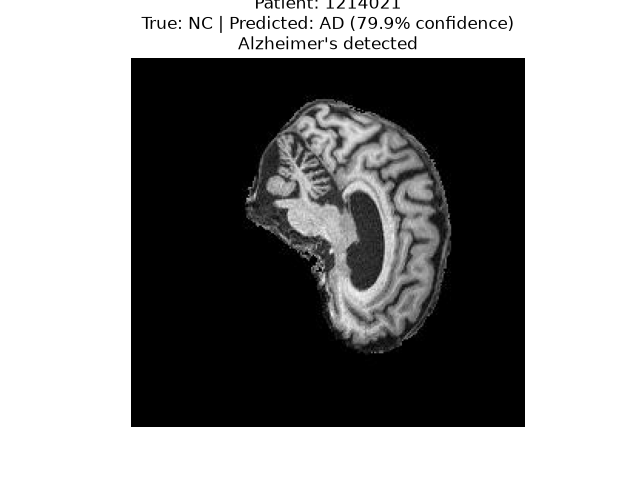|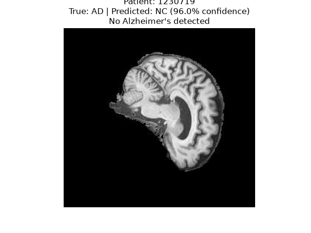|

Correct Prediction:

The top right image above appears to be incredibly low resolution, with the brain stem cut off. This may be a part of why it was misclassified. All slices are confident enough that unless other slices within the scan are showing clear (according to the model) signs of Alzheimer's, the doctor's review system proposed would not catch them. 

## Recommendation
ConvNeXt as a model appears to benefit large datasets, like ImageNet, far more than smaller datasets like the ADNI trained here. The model saw no marked improvement over standard ResNet-50 on this data, performing worse in every metric bar 'nc_called_ad'. Neither model achieved 0.8 test accuracy on slice or patient data, though 0.784 is quite close. 

I would recommend first that a larger dataset be accquired before attempting to retrain on ConvNeXt. In lieu of a larger dataset, I would recommend trying to adjust the numbers in the 'patient_rule' function of predict.py to try and flag as many Alzheimer's patients as possible.

If you are confident in continuing to use ConvNeXt or ResNet-50, both of which I discourage, I would suggest finding ways to better regularise the data and prevent overconfident guesses.

## 8 - Artificial Intelligence Usage Disclosure

Claude was the only LLM used while making this model. It aided in model scaffolding, the transition from my ResNet-18 implementation to ResNet-50, and highlighting where in the paper 'A ConvNet for the 2020s' they mention the changes made to ResNet. It was uesd to help write the mixup and layernorm part of the ConvNeXt code. It was also used to help adjust the training algorithm and to get the evaluation data used in predict.py. It was also used to help quickly write the additional evaluation files. Again all code was double checked. AI was at no point used in writing this report and all work here is my own.

All code from AI was individually verified before being used within the model. None of it being blindly copy-pasted. When getting it to highlight the changes the paper made, I asked for specific references and coroborated them myself before implementing them. 

Hyperparameter weights were drawn from the paper initially and adjusted by me, so no AI was used in tuning the model.

# References
[1] 'A ConvNet for the 2020s' - https://arxiv.org/pdf/2201.03545

[2] 'Deep Residual Learning for Image Recognition' - https://arxiv.org/pdf/1512.03385

[3] 'mixup: Beyond Empirical Risk Minimization' - https://arxiv.org/pdf/1710.09412
 